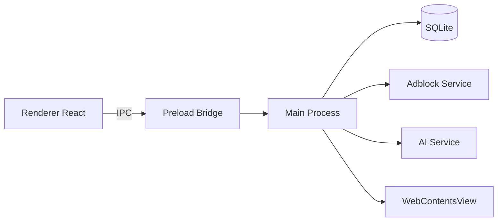

# PiFlex Browser

[](LICENSE)
[](CHANGELOG.md)
[](#)
[](#)

PiFlex is a lightweight, privacy-focused desktop browser built on Electron, React, and TypeScript. It pairs a hardened Chromium view with a fast native-feeling shell, a network-level ad/tracker blocker, and an optional on-device AI assistant.

## Overview

PiFlex runs web content in isolated `WebContentsView` instances while the trusted React shell provides tabs, bookmarks, history, downloads, passwords, extensions, find-in-page, permissions, and session restore. Privileged operations flow through an allow-listed IPC bridge. Nothing is sent to a cloud service by default for AI features.

## Features

- Privacy first — network-layer ad/tracker blocking, per-site exemptions, DNT/GPC, isolated private-tab session
- Local AI assistant — curated GGUF models + managed llama.cpp runtime, first-run auto-provision
- Real browser chrome — tabs, bookmarks bar, history, downloads, passwords, extensions, find-in-page, permissions, session restore
- Fast internal pages — `piflex://newtab`, `bookmarks`, `history`, `downloads`, `passwords`, `extensions`, `settings`, `help`, `diagnostics`, `about`
- Cross-platform — Windows, Linux, macOS via electron-builder

## Technology Stack

| Technology | Purpose |
| --- | --- |
| Electron 45 | Desktop runtime / main process |
| React 19 | Frontend UI |
| TypeScript 5.9 | Language |
| Vite 7 | Bundler / dev server |
| Tailwind CSS 4 | Styling |
| Zustand | State management |
| better-sqlite3 | Persistence |
| electron-builder | Packaging |

## Prerequisites

- Node.js >= 20.19.0 (project uses Node 24, see `.nvmrc`)
- npm 11+
- Platform toolchain for native modules

## Installation

```bash
git clone https://github.com/Harisudhan4127/piflex-browser.git
cd piflex-browser
npm ci
```

## Development

```bash
npm run dev          # Vite (port 5123) + Electron
npm run typecheck    # tsc --noEmit
npm test             # unit/regression suite
npm run build:renderer
npm run smoke
```

## Environment Variables

| Variable | Purpose | Required | Example |
| --- | --- | --- | --- |
| `PIFLEX_DEV_SERVER` | Dev server URL for Electron | Optional | `http://localhost:5123` |

## Build & Distribution

```bash
npm run build        # production renderer build
npm run dist:win     # Windows NSIS + portable
npm run dist:linux   # AppImage + deb
npm run dist:mac     # dmg + zip
```

Artifacts written to `release/`.

## Testing

```bash
npm test
npm run typecheck
npm run verify       # typecheck + test + build
```

## Security & Privacy

- Web content isolated: `nodeIntegration: false`, `contextIsolation: true`, `sandbox: true`
- Preload exposes only allow-listed IPC channels
- Ad blocking network-level only; no TLS interception
- Page/selection text redacted before AI model input
- Report vulnerabilities privately per `SECURITY.md`

## Architecture



## Project Structure

```
core/          Browser-independent logic
src/main/      Electron main process
src/preload/   Context bridge
src/renderer/  React shell + internal pages
src/shared/    IPC channel map + types
tests/         Unit/regression tests
docs/          Documentation
```

## Troubleshooting

- Native module ABI mismatch: rebuild `better-sqlite3` for Electron
- Missing build tools on Windows: install Visual Studio Build Tools
- Dev server not reachable: ensure Vite on port 5123

## Contributing

See `CONTRIBUTING.md`. By participating you agree to the Code of Conduct.

## License

Proprietary © 2026 Harisudhan Baskaran. All rights reserved. See [LICENSE](LICENSE).

## Acknowledgments

Built on Electron, React, TypeScript, Vite, Tailwind CSS, better-sqlite3, and llama.cpp.
