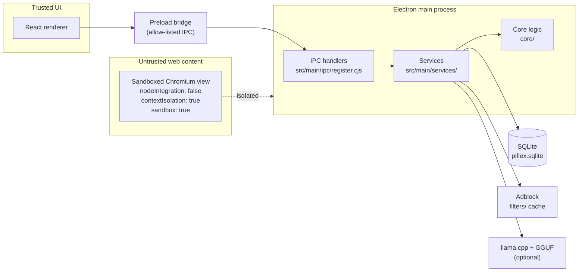

<div align="center">

# 🌐 PiFlex Browser v2.0.0

**A privacy-first Electron browser with built-in ad/tracker blocking and optional on-device AI.**


[Repository](https://github.com/Harisudhan4127/piflex-browser) · [README](README.md) · [Known Issues](#-known-issues--limitations)

</div>

---

## 📌 Release at a Glance

| | |
|---|---|
| **Project** | PiFlex Browser |
| **Version** | 2.0.0 |
| **Type** | Feature release (draft; tag `v2.0.0` pushed to `main`) |
| **Stack** | Electron · React · TypeScript · Vite · Tailwind · better-sqlite3 |
| **Upgrade** | No migration needed for fresh installs |

## ✨ Summary

PiFlex 2.0.0 consolidates the browser shell, IPC contract, data layer, ad blocker, AI runtime provisioning and documentation into one release. Web content runs in a hardened Chromium view, tracking is blocked at the network level, and AI is strictly optional and local-first.

---

## 🚀 Highlights

| | Feature | Why it matters | Scope |
|---|---|---|---|
| 🛡️ | **Network-level ad & tracker blocking** via `session.webRequest` | Less tracking, with no TLS interception | All browsing sessions |
| 🤖 | **On-device AI** using managed llama.cpp + GGUF models | Private assistance, no cloud by default | Optional |
| 🔒 | **Allow-listed preload IPC bridge** returning `{ ok, data } \| { ok, error }` | Least-privilege boundary between UI and web content | Security |

---

## 🧱 Architecture



---

## 📝 Changelog

### ➕ Added
- **Internal pages:** New Tab, Bookmarks, History, Downloads, Passwords, Extensions, Settings, Help, Diagnostics, About
- **Persistence:** SQLite (`piflex.sqlite`) for bookmarks, history, credentials and autofill
- **Ad/tracker filters:** cached under `filters/`
- **AI provisioning:** runtime and model download with progress reporting

### 🔄 Changed
- Web content is isolated with `nodeIntegration: false`, `contextIsolation: true`, `sandbox: true`

### 🐞 Fixed
- IPC window/tab errors and QA defects (`765cdb0`)
- Adblock crash safety and runtime win detection (`6b2b01f`)

### 🔐 Security
- Page and selection text is redacted before it reaches the AI model
- No cloud AI by default

---

## 💻 Platform Support

| Platform | Architecture | Packages | Status |
|---|---|---|---|
| 🪟 Windows | x64 | NSIS, portable | ⚙️ Configured, not yet verified |
| 🐧 Linux | x64 | AppImage, deb | ⚙️ Configured, not yet verified |
| 🍎 macOS | x64 / arm64 | dmg, zip | ⚙️ Configured, not yet verified |
| 🍓 Linux ARM (Raspberry Pi) | arm64 / armhf | — | ❌ Not configured in this release |
| 🤖 Android | — | — | ❌ Not supported (Electron) |

> **Legend:** ⚙️ configured in `electron-builder` but not built and run on real hardware · ❌ unsupported

---

## ✅ Testing

| Check | Result | Notes |
|---|---|---|
| Unit tests (`npm test`) | ✅ 58 passed, 0 failed | Executed |
| Type check (`npm run typecheck`) | ✅ Pass | Executed |
| Renderer build (`npm run build:renderer`) | ⏳ Not run | Run before publishing the release |
| Installer builds per platform | ⏳ Not run | |
| Memory / startup benchmarks | ⏳ Not measured | No performance claims are made in this release |

---

## ⚠️ Known Issues & Limitations

- No defects are known, but QA beyond unit tests and type checking has **not** been performed.
- Raspberry Pi / ARM Linux builds are not yet configured, despite the project's ARM focus.
- Credential storage protection (encryption at rest) is not documented here. Verify and document it before shipping the Passwords page.
- Extensions page: scope and compatibility are not yet documented.

---

## 🛠️ Installation & Upgrade

```bash
git clone https://github.com/Harisudhan4127/piflex-browser
cd piflex-browser
npm install
npm start
```

See [README.md](README.md) for packaging. Existing user data lives in Electron `userData/data`.

## 📦 Dependencies

| Runtime | Development |
|---|---|
| Electron, React, better-sqlite3, zustand, Radix UI | Vite, TypeScript, Tailwind, electron-builder |

## 👩‍💻 Developer Notes

| Area | Location |
|---|---|
| IPC handlers | `src/main/ipc/register.cjs` |
| Services | `src/main/services/` |
| Core logic | `core/` |

## 🧾 Verification Summary

Commands run: `npm test` ✅ · `npm run typecheck` ✅ — pushed to `main`.

## 🗂️ Release History

| Version | Status |
|---|---|
| **v2.0.0** | Current (draft) |

---

<div align="center"><sub>PiFlex Browser · Proprietary License © 2026 Harisudhan Baskaran</sub></div>
